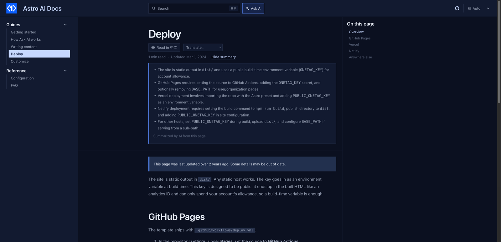

# starlight-reading-time

**"5 min read · Updated Mar 3, 2026"** under every [Starlight](https://starlight.astro.build) page title, and a clear note on pages that have not been touched in a long time. Free, no account, no backend.



- **Reading time that handles every language.** Words for English and other space-separated languages, characters for Chinese, Japanese and Korean. Code blocks are not counted.
- **Last updated, where readers look first.** Uses the date Starlight already knows (`lastUpdated: true` from git, or `lastUpdated` in frontmatter) and shows it next to the reading time.
- **Outdated note.** Pages older than a year (configurable) get a short "may be out of date" note at the top, so readers know before they follow old steps.
- Text in English, 简体中文, 日本語, Español, Français, Deutsch, Português and 한국어, following the page language.
- **Optional AI switch**: with `ai: true`, a **Summarize** link appears next to the reading time and shows the key points of the page.

## Install

```bash
npm install starlight-reading-time
```

```js
// astro.config.mjs
import { defineConfig } from "astro/config";
import starlight from "@astrojs/starlight";
import starlightReadingTime from "starlight-reading-time";

export default defineConfig({
  integrations: [
    starlight({
      title: "My docs",
      lastUpdated: true, // optional: dates from git, for "Updated" and the outdated note
      plugins: [starlightReadingTime()],
    }),
  ],
});
```

## Options

| Option | Default | What it does |
| --- | --- | --- |
| `wordsPerMinute` | `220` | Reading speed for space-separated languages. |
| `charsPerMinute` | `400` | Reading speed for Chinese, Japanese and Korean. |
| `minMinutes` | `1` | Shortest time shown. |
| `showUpdated` | `true` | Show the last-updated date next to the reading time. |
| `outdatedAfterDays` | `365` | Show the outdated note after this many days. `0` turns it off. |
| `labels` | built-in | Override text, e.g. `{ outdated: "Check the changelog before following these steps." }`. |
| `exclude` | `[]` | Paths to skip, e.g. `["/changelog/*"]`. Splash pages are skipped already. |
| `ai` | `false` | `true` (or `{ key }`) adds a Summarize link. |

## The AI switch

```js
starlightReadingTime({ ai: true })
```

A **Summarize** link appears after the reading time; one click lists the key points of the page in 3 to 5 bullets. It runs in the browser through [OneTag AI](https://onetagai.com/?ref=starlight-reading-time); on localhost it works right away on a shared demo key. A deployed site needs a free key, set as `PUBLIC_ONETAG_KEY` in `.env` or `ai: { key: "ot_..." }`: enter an email at onetagai.com and the key arrives in your inbox, no password, no card. The AI code loads only when a reader clicks.

With the switch off (the default) nothing AI-related is loaded.

## More for Starlight

- [starlight-page-feedback](https://github.com/fengyiqicoder/starlight-page-feedback): "Was this page helpful?", sent to the analytics you already run.
- [starlight-onetag](https://github.com/fengyiqicoder/starlight-onetag): Ask AI, AI answers in search, page translation for readers, Explain this code.

## License

MIT.
